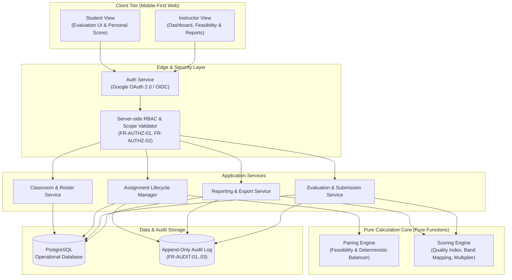

# System Architecture: PairEval

## Implemented pilot (2026-10-15)

One deployable Next.js App Router application serves the Thai UI and REST API. Auth.js validates Google identity; `src/domain/service.ts` validates membership, role, classroom and pair ownership for each request. `src/domain/pairing.ts` uses deterministic feasible circulation to balance unequal groups. `src/domain/scoring.ts` computes scoped Decimal scores; the tested participation/report functions remain in `src/core`.

Drizzle persists to PostgreSQL through a small connection pool (`prepare: false` for Supabase transaction pooling). Mutations lock the classroom row inside a database transaction, so retries/concurrent serverless invocations share the same integrity boundary. Submission keys are scoped to assignment/user; drafts, submitted values and immutable revisions are distinct. Finalization freezes configuration, formula version, assigned pairs, submitted inputs and computed outputs. Overrides append new records.

The `paireval_app` runtime role has explicit table grants and RLS policies; the migration role is used separately. Audit records are stored in a separate append-only schema in the same database. This prevents runtime alteration but is not protection against a database administrator. Default Supabase REST roles receive no application policies. Tests exercise the restricted role and encrypted restore on disposable PostgreSQL.

The prototype Express server and memory store remain solely for regression tests; they are not the production entrypoint. The architecture below describes the logical boundaries. Deferred capabilities and external release checks are tracked in `backlog.md` and `ws-evidence.md`.

## 1. Architectural Overview

PairEval ถูกออกแบบตามหลักการ **Separation of Concerns** และ **Functional Core, Imperative Shell** โดยแยกส่วนการคำนวณที่ต้องตรวจสอบความถูกต้องทางสถิติ (Pairing & Scoring Engine) ออกมาเป็น **Pure Functions** ที่ไม่มี side-effects หรือ state ภายใน เพื่อให้การคำนวณสามารถทำซ้ำได้ (Reproducible) 100%

## 2. Architectural Principles

- **AR-01 (Pure Function Scoring Core)**: Scoring Engine ต้องเป็น Pure Function ที่รับ input parameters และ comparisons แล้วส่งคืนคะแนนโดยไม่มีการเก็บ state ภายใน ทำให้ audit และ recompute ย้อนหลังได้อย่างเที่ยงตรง
- **AR-02 (Centralized Evaluator Anonymity Layer)**: ทุก query หรือ API endpoint ที่เข้าถึงข้อมูลดิบ ต้องผ่าน Authorization & Anonymization Layer เพื่อป้องกันการรั่วไหลของตัวตนผู้ประเมินไปยังนักศึกษา (FR-ANON-01)
- **AR-03 (Append-Only Audit Log)**: ทุกการกระทำที่มีผลต่อการกำหนดสิทธิ์, การ override คะแนน, การ publish/unpublish และการเข้าถึงตัวตน ต้องถูกบันทึกลงใน storage ที่เป็น append-only โดยไม่มี API ให้แก้ไขหรือลบได้
