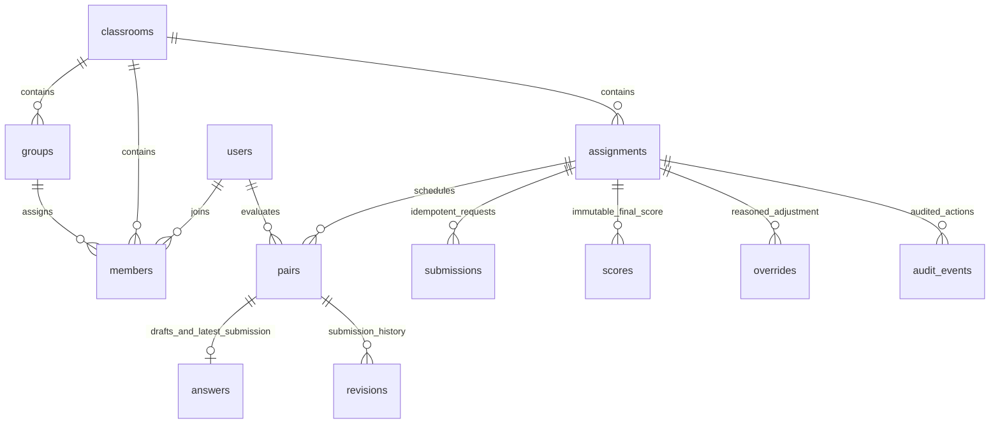

# Persistent model

Assignment criteria/configuration and immutable calculation snapshots are JSONB. Each persisted pair carries criterion ID, side, generation and displayed-left item. Answers keep draft and submitted choices separately. Final numeric scores use `numeric(14,8)`. All timestamps use UTC. Audit events reside in the `audit` schema and reject update/delete in the database.
